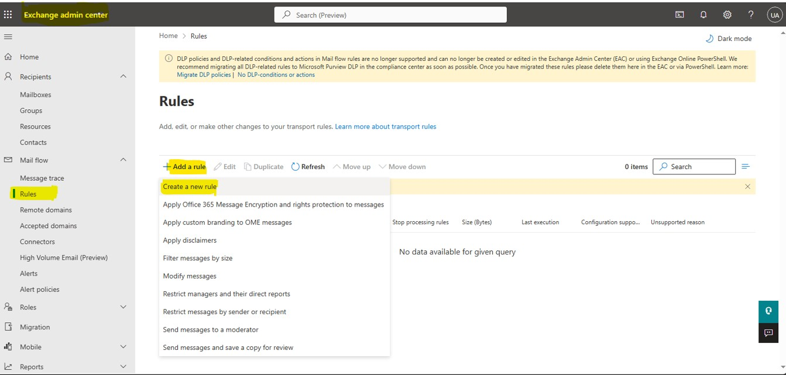
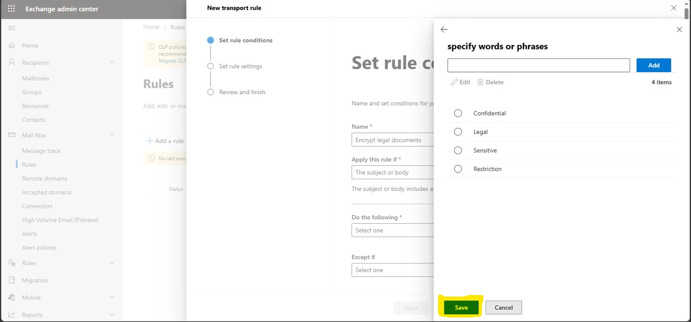
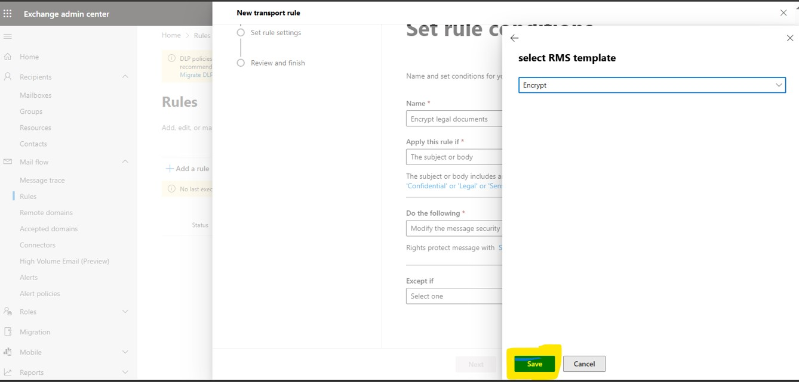
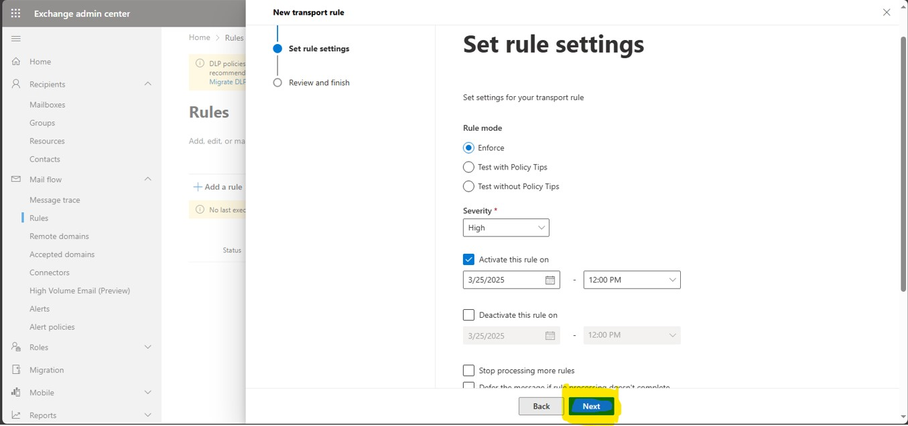
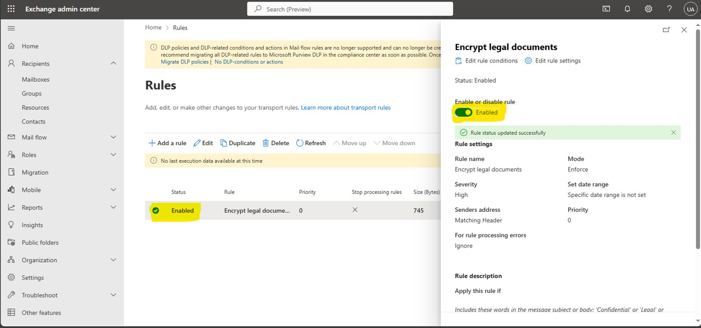
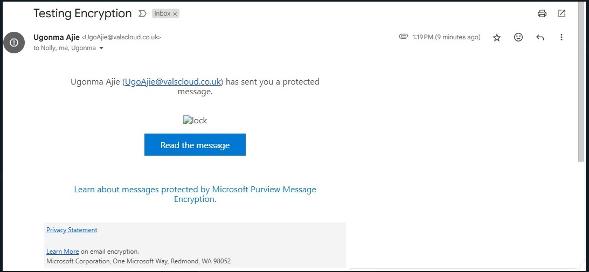
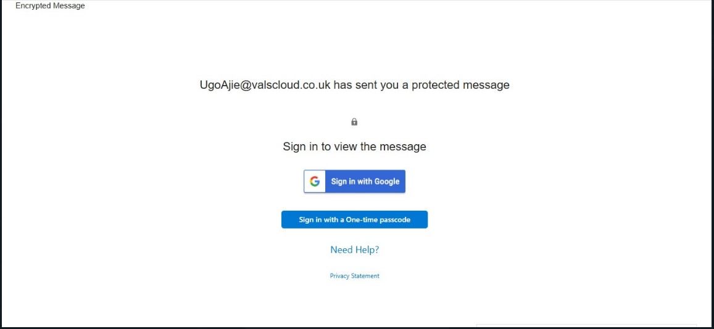
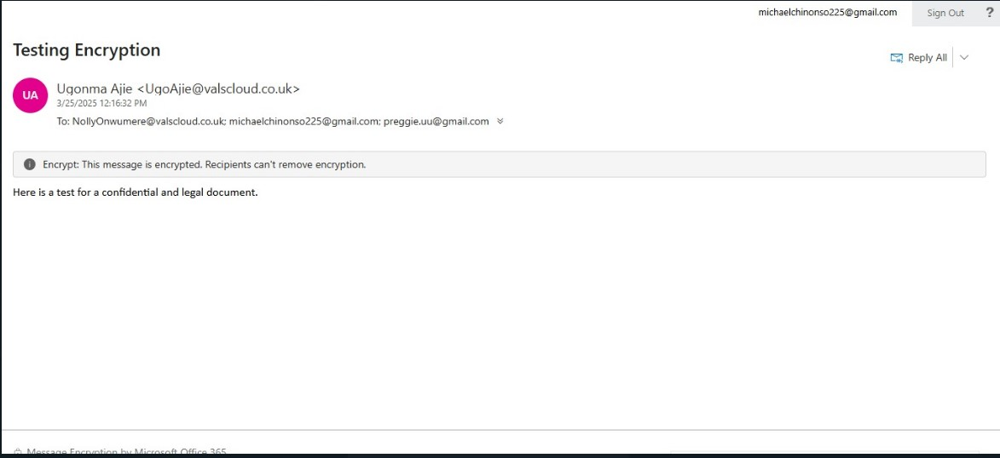

## Implementing Email Encryption for Sensitive Documents Using Microsoft 365.

## Overview

A law firm wants to ensure that emails containing sensitive legal documents are encrypted when sent externally.

## Requirements
* Encrypt emails containing sensitive legal documents
* Ensure encryption is applied when sending emails externally
* Use Microsoft 365 (M365) to implement the solution

## Solution
1. Created a Mail Flow rule to detect and encrypt sensitive emails

## Implementation Steps

### Step 1: Created a Mail Flow Rule

* Go to the Microsoft 365 Exchange Admin Center: https://admin.cloud.microsoft/exchange#/mailboxes

* Navigated to Mail flow > Rules
  

---
* Created a new rule to detect and encrypt sensitive emails

---
### Step 2

#### Successfully tested the solution to ensure emails containing sensitive legal message are encrypted when sent externally

* Sent an encrypted email to a recipient and verified that they could access the email and its contents and was prompted to authenticate before accessing the email contents
  

---

* Confirmed that the recipient was able to access the email contents after authenticating
  

End.
